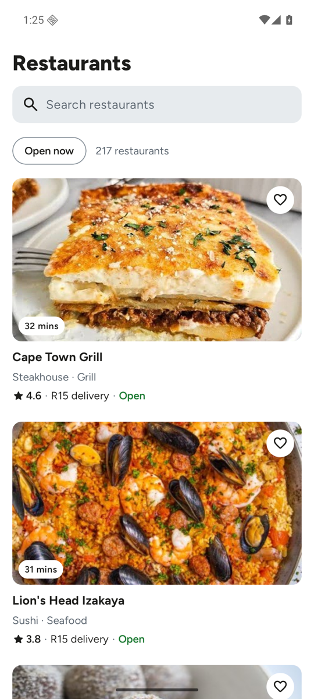
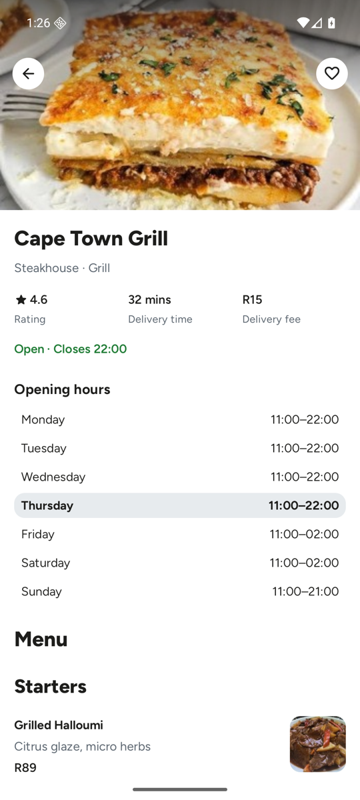
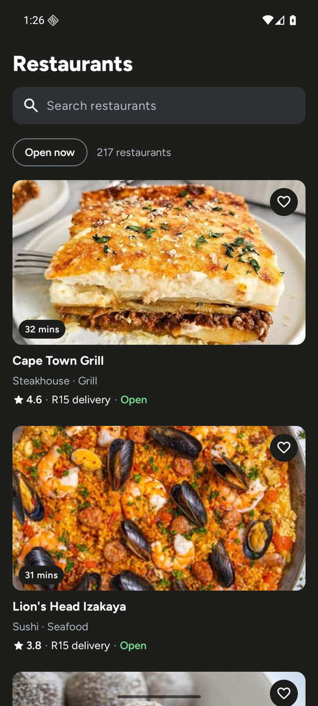

# Mr D Restaurant Discovery

A restaurant discovery mini-app for the Mr D Senior Android Engineer take-home. You can browse nearby restaurants, search by name, filter to what's open now, open a restaurant's details and menu, and keep favourites, and it all works offline. It's written in Kotlin and Jetpack Compose, with multiple modules, and built to slot into a large app maintained by several squads.

> **Status:** version 1.0.0. Everything in the [design spec](docs/specs/2026-11-18-restaurant-discovery-design.md) is built, and the signed APK is on the [Releases page](https://github.com/Effekt3r/mrd-restaurant-discovery/releases). [SOLUTION.md](SOLUTION.md) explains the design, its trade-offs, Task 3 and the [known limitations](SOLUTION.md#known-limitations), and [AI_USAGE.md](AI_USAGE.md) how I used AI, with my prompts.

| Browse | Details | Dark theme |
|---|---|---|
|  |  |  |

Screenshots from the R8 release build on the emulator. [`docs/qa/`](docs/qa/) has the rest, with each milestone's verification report.

## Requirements

| Tool | Version | Notes |
|---|---|---|
| Android Studio | Rabbit 2 (2026.2.2) or newer | The first version that [supports AGP 9.5](https://developer.android.com/studio/releases). |
| JDK | 17 or newer (21 recommended) | Runs Gradle. Android Studio's bundled JDK works. |
| Android SDK | Platform 37 and Build-Tools 36 | Install them with the SDK Manager. The app compiles against API 37 and targets API 36. |
| Device or emulator | Android 8.0 (API 26) or newer | Gesture or three-button navigation. |
| Gradle | 9.8.2 | Comes with the wrapper; there's nothing to install. |
| gitleaks | 8.x (optional) | Scans each commit for secrets (`brew install gitleaks`). |

## Getting started

On the command line, Gradle needs to know where the Android SDK is: set `ANDROID_HOME`, or put `sdk.dir=<absolute path to the SDK>` in `local.properties` (Gradle doesn't expand `~`). That file is git-ignored, and Android Studio writes it for you when it opens the project.

```sh
git clone https://github.com/Effekt3r/mrd-restaurant-discovery.git
cd mrd-restaurant-discovery
git config core.hooksPath .githooks   # optional: secret scan on every commit
./gradlew installDebug                # build and install on a connected device or emulator
```

Or open the folder in Android Studio and run the `app` configuration.

**Or install the release.** Each [release](https://github.com/Effekt3r/mrd-restaurant-discovery/releases) has an R8-minified APK signed with the upload key: download it and run `adb install mrd-restaurant-discovery-v1.0.0.apk`.

## Deep link

`mrd://restaurant/{id}` opens that restaurant's Details, with Browse underneath, whether the app is running, closed, or killed by Android in the background:

```sh
adb shell am start -W -a android.intent.action.VIEW -d "mrd://restaurant/r-1001" com.effekt3r.mrd
```

An id the app doesn't know shows "Restaurant not found". Opened offline before the app has ever loaded its restaurants, Details says so and offers Retry.

## Testing

| What | Command |
|---|---|
| Unit, Robolectric and architecture tests, in every module | `./gradlew testDebugUnitTest` |
| Formatting check (fix with `spotlessApply`) | `./gradlew spotlessCheck` |
| Lint | `./gradlew :app:lintDebug` |
| R8-minified release build | `./gradlew :app:assembleRelease` |
| Check that R8 ran and found no missing keep rules | `test -s app/build/outputs/mapping/release/mapping.txt && test ! -s app/build/outputs/mapping/release/missing_rules.txt` |
| The staleness measurement in SOLUTION.md | `./gradlew :core:data:testDebugUnitTest --tests '*StalenessMeasurementTest'` |
| The prompt extractor's self-check | `python3 tools/ai/extract_prompts.py --check` |

Every test runs on the JVM, so no emulator is needed. CI runs all of the first five on every pull request into `dev` and `master`, plus a gitleaks scan of the full history. The [architecture-test probes](tools/architecture-probes/README.md) prove that each house rule fails when it's broken.

## Toolchain and version policy

- **Proven over newest.** The project started on the toolchain Google's [Now in Android](https://github.com/android/nowinandroid) built with (Gradle 9.7, AGP 9.3, Kotlin 2.3, KSP 2.3 and Hilt 2.59), with libraries that had been out for at least four weeks. A throwaway spike build proved the set before any project code was written. A time-boxed build has no room for toolchain surprises, and a large app updates on purpose.
- **Then Dependabot's updates.** Dependabot proposes updates weekly, once a library release is 30 days old and an action's is 7. On 2026-11-19 I took its first round, each merged after CI passed: AGP 9.5.1, Kotlin 2.4.21, KSP 2.3.12, Hilt 2.60.1, Gradle 9.8.2, kotlinx.serialization 1.12.0, Spotless 8.10.4 with ktlint 1.8.0, and the androidx 2026.09 group. The toolchain is now ahead of Now in Android's.
- **The exceptions:**
  - **Compile SDK 37, target SDK 36.** Compose 1.12, Core 1.19, Navigation 2.10 and androidx.hilt 1.4 need compile SDK 37. The [target SDK](https://developer.android.com/build#android_sdk_settings), not the compile SDK, decides which platform behaviour the app gets, so it stays at 36 until the app has been tested against Android 17's.
  - **Activity and Lifecycle resolve higher than the catalog.** It pins Activity 1.12.4 and Lifecycle 2.10.0, but Navigation 2.10 and androidx.hilt 1.4 pull in 1.13.0 and 2.11.0, because Gradle treats a catalog version as a minimum.
  - **Konsist stays at 0.17.3,** the version the spike validated. 0.18 needed Kotlin 2.4 while the project was on 2.3, and an upgrade means re-running every architecture probe.
  - **Gradle's own Kotlin.** `build-logic` is compiled with the Kotlin embedded in Gradle, 2.4.10, not the project's 2.4.21. [SECURITY.md](SECURITY.md#open-dependabot-alerts) says why that matters.

The [version catalog](gradle/libs.versions.toml) is the source of truth. The main versions:

| Area | Version |
|---|---|
| Gradle | 9.8.2 (wrapper, checksum-verified) |
| Android Gradle Plugin | 9.5.1 (built-in Kotlin) |
| Kotlin / KSP | 2.4.21 / 2.3.12 |
| Hilt / androidx.hilt | 2.60.1 / 1.4.0 |
| Compose BOM | 2026.09.00 (Compose 1.12) |
| Core / Navigation | 1.19.1 / 2.10.2 |
| Activity / Lifecycle | 1.13.0 / 2.11.0 (resolved; the catalog says 1.12.4 / 2.10.0) |
| Room / Paging | 2.8.4 / 3.4.2 |
| Retrofit / OkHttp | 3.0.0 / 5.3.2 |
| Coil | 3.4.0 |
| kotlinx.serialization / coroutines | 1.12.0 / 1.10.2 |
| JUnit / Robolectric / Turbine / Konsist | 4.13.2 / 4.16.1 / 1.2.1 / 0.17.3 |
| Spotless / ktlint | 8.10.4 / 1.8.0 |
| SDK levels | compile 37, target 36, minimum 26 |

## Mock API

The app's restaurants come from static JSON in this repository, served over HTTPS by `raw.githubusercontent.com`. The `dev` branch plays the part of staging and `master` of production: debug builds read `dev` and release builds `master`.

| Endpoint | What it returns |
|---|---|
| [`v1/restaurants.json`](mock-api/v1/restaurants.json) | 220 restaurants: what the app shows |
| [`v1/restaurants-10k.json`](mock-api/v1/restaurants-10k.json) | 10,000 restaurants for the stress test; the first 220 are the same restaurants |
| [`v1/menus/{id}.json`](mock-api/v1/menus/) | A menu for each of the 218 distinct ids in `restaurants.json`. Stress-only restaurants have none, and the API answers 404. |

For example, Cape Town Grill's menu on staging: https://raw.githubusercontent.com/Effekt3r/mrd-restaurant-discovery/dev/mock-api/v1/menus/r-1001.json

- **The stress dataset.** `./gradlew installDebug -Pmrd.dataset=10k` installs a debug build that reads the 10,000-restaurant file.
- **Another server.** `-Pmrd.apiBaseUrl=<an https URL ending in />` points a build at another copy of `mock-api/`.
- **Regenerating.** The data is fictional and deliberately messy, so the app's fallbacks get exercised. `./gradlew :tools:datagen:run` regenerates every file from the committed image pool, with no network, and a golden test fails if a committed file differs from what the generator writes. `./gradlew :tools:datagen:run --args=fetch-images` refreshes the image pool from TheMealDB; regenerate afterwards.

[`mock-api/README.md`](mock-api/README.md) has the schema, the edge cases and the image credits.

## Signing

Release builds are R8-minified. The release signing key comes from Gradle properties or environment variables, never from the repository:

| Property | Meaning |
|---|---|
| `MRD_KEYSTORE_FILE` | Path to the upload keystore. Use an absolute path: a relative one resolves against `app/`. |
| `MRD_KEYSTORE_PASSWORD` | Keystore password |
| `MRD_KEY_ALIAS` | Key alias |
| `MRD_KEY_PASSWORD` | Key password |

Without them, a local release build is signed with the debug key, and Gradle prints a warning. That way anyone can install and test an R8 build.

The [release workflow](.github/workflows/release.yml) requires the real key:
- It runs for each `v*` tag, in the `release` environment, which only `v*` tags can deploy from. The signing secrets live only there; the repository has none.
- It decodes the upload keystore into the runner's temporary folder and builds with `-Pmrd.requireReleaseSigning=true`, which makes a build without a keystore fail. It passes the secrets as environment variables, not `-P` arguments, which would show up in process listings.
- It checks that R8 ran and found no missing keep rules, and that the APK's signing certificate is the upload key's. Only then does it create the GitHub Release with the APK attached. R8's `mapping.txt` stays with the workflow run, for de-obfuscating stack traces.

The upload keystore is kept outside the repository and is never committed. On Google Play, Play App Signing would hold the app signing key; [SOLUTION.md](SOLUTION.md#key-decisions-and-trade-offs) explains the difference.

## Project structure

| Module | Role | Would be owned by |
|---|---|---|
| `:app` | Host shell: Application, MainActivity, the navigation graph, the deep link's intent filter, R8 and signing | Mobile Platform |
| `:feature:browse` | Browse screen and ViewModel | Discovery squad |
| `:feature:details` | Details screen and ViewModel, with the menu | Discovery squad |
| `:core:data` | Restaurant and menu API, Room database, repositories, sync | Discovery squad |
| `:core:model` | Domain types and the open-status rules (plain Kotlin) | Discovery squad |
| `:core:ui` | Restaurant UI shared by both features | Discovery squad |
| `:core:network` | Shared HTTP client, JSON, the image loader and connectivity | Mobile Platform |
| `:core:common` | Dispatchers, clock, minute ticker and the connectivity interface (plain Kotlin) | Mobile Platform |
| `:core:designsystem` | Mr D tokens, Figtree, `MrdTheme` and components | Design Platform |
| `:core:testing` | Test rules, fakes and a test clock | Mobile Platform |
| `build-logic/` | Convention plugins (`mrd.*`) | Mobile Platform |
| `tools/datagen` | Build-time generator for the mock API's data; never ships in the app | Discovery squad |
| `tools/ai` | Extracts my prompts from Claude Code's session logs into [`docs/ai/prompts.md`](docs/ai/prompts.md) | |
| `mock-api/` | The mock API's JSON, served by `raw.githubusercontent.com` | Discovery squad |

Features never depend on each other. The build enforces it, and so do the architecture tests.

## Documentation

- [SOLUTION.md](SOLUTION.md): the design, its trade-offs, Task 3 and the measured improvement
- [AI_USAGE.md](AI_USAGE.md): how I used AI, my decisions, and [my prompts](docs/ai/prompts.md)
- [Design spec](docs/specs/2026-11-18-restaurant-discovery-design.md). Its §14 links every technology to its official documentation.
- [Roadmap and milestone plans](docs/plans/), and each milestone's [verification report](docs/qa/)
- [Corrections log](docs/ai/corrections.md): every time the AI was wrong, and what caught it
- [Architecture-test probes](tools/architecture-probes/README.md): proof that each house rule fails when it's broken
- [How we work](CONTRIBUTING.md) · [Security](SECURITY.md)

| Technology | Official documentation |
|---|---|
| App architecture | https://developer.android.com/topic/architecture |
| Offline-first data layer | https://developer.android.com/topic/architecture/data-layer/offline-first |
| Modularization | https://developer.android.com/topic/modularization |
| Convention plugins | https://docs.gradle.org/current/userguide/sharing_build_logic_between_subprojects.html |
| Version catalogs | https://developer.android.com/build/migrate-to-catalogs |
| Jetpack Compose | https://developer.android.com/develop/ui/compose/documentation |
| Lazy lists and grids | https://developer.android.com/develop/ui/compose/lists |
| Text fields (`TextFieldState`) | https://developer.android.com/develop/ui/compose/text/user-input |
| Pull to refresh | https://developer.android.com/develop/ui/compose/components/pull-to-refresh |
| Nested scrolling (the header that slides away) | https://developer.android.com/develop/ui/compose/touch-input/pointer-input/scroll |
| Stability in Compose | https://developer.android.com/develop/ui/compose/performance/stability |
| Custom design systems (theming Material 3) | https://developer.android.com/develop/ui/compose/designsystems/custom |
| Fonts and variable fonts | https://developer.android.com/develop/ui/compose/text/fonts |
| Material Symbols in Compose | https://developer.android.com/develop/ui/compose/graphics/images/material |
| Adaptive icons | https://developer.android.com/develop/ui/compose/system/icon_design_adaptive |
| Edge-to-edge (window insets) | https://developer.android.com/develop/ui/compose/system/insets |
| Accessibility in Compose | https://developer.android.com/develop/ui/compose/accessibility |
| ViewModel | https://developer.android.com/topic/libraries/architecture/viewmodel |
| Saved state in a ViewModel | https://developer.android.com/topic/libraries/architecture/viewmodel/viewmodel-savedstate |
| StateFlow | https://developer.android.com/kotlin/flow/stateflow-and-sharedflow |
| Kotlin coroutines | https://developer.android.com/kotlin/coroutines |
| Lifecycle-aware coroutines | https://developer.android.com/topic/libraries/architecture/coroutines |
| Navigation (type safety) | https://developer.android.com/guide/navigation/design/type-safety |
| Deep links | https://developer.android.com/guide/navigation/design/deep-link |
| Predictive back | https://developer.android.com/guide/navigation/custom-back/predictive-back-gesture |
| Hilt | https://developer.android.com/training/dependency-injection/hilt-android |
| Room | https://developer.android.com/training/data-storage/room |
| Paging | https://developer.android.com/topic/libraries/architecture/paging/v3-overview |
| Paging (paged data in Compose) | https://developer.android.com/topic/libraries/architecture/paging/v3-paged-data |
| Retrofit | https://lysine.dev/retrofit/ |
| OkHttp | https://lysine.dev/okhttp/ |
| kotlinx.serialization (JSON) | https://kotlinlang.org/docs/serialization.html |
| Loading images (Coil) | https://developer.android.com/develop/ui/compose/graphics/images/loading |
| Coil | https://coil-kt.github.io/coil/ |
| Reading network state | https://developer.android.com/develop/connectivity/network-ops/reading-network-state |
| Network security config | https://developer.android.com/privacy-and-security/security-config |
| R8 | https://developer.android.com/topic/performance/app-optimization/enable-app-optimization |
| App signing | https://developer.android.com/studio/publish/app-signing |
| Play App Signing | https://support.google.com/googleplay/android-developer/answer/9842756 |
| Lint | https://developer.android.com/studio/write/lint |
| Spotless | https://github.com/diffplug/spotless |
| Robolectric | https://developer.android.com/training/testing/local-tests/robolectric |
| Testing Room | https://developer.android.com/training/data-storage/room/testing-db |
| Testing Paging | https://developer.android.com/topic/libraries/architecture/paging/test |
| Testing coroutines | https://developer.android.com/kotlin/coroutines/test |
| Testing flows (Turbine) | https://developer.android.com/kotlin/flow/test |
| Turbine | https://github.com/cashapp/turbine |
| Testing Compose | https://developer.android.com/develop/ui/compose/testing |
| Konsist | https://docs.konsist.lemonappdev.com/ |
| Gradle application plugin (the data generator) | https://docs.gradle.org/current/userguide/application_plugin.html |
| GitHub Actions | https://docs.github.com/en/actions |
| Deployment environments | https://docs.github.com/en/actions/how-tos/deploy/configure-and-manage-deployments/manage-environments |
| Rulesets | https://docs.github.com/en/repositories/configuring-branches-and-merges-in-your-repository/managing-rulesets/about-rulesets |
| Dependabot security updates | https://docs.github.com/en/code-security/concepts/supply-chain-security/dependabot-security-updates |
| gitleaks | https://github.com/gitleaks/gitleaks |
| TheMealDB API (food photos) | https://www.themealdb.com/api.php |

## Credits

- **Figtree**, the app's typeface, is by Erik Kennedy and the Figtree Project Authors, under the [SIL Open Font License 1.1](core/designsystem/FIGTREE-OFL.txt). The app bundles the variable font from [google/fonts](https://github.com/google/fonts/tree/main/ofl/figtree).
- **Icons** are Google's [Material Symbols](https://fonts.google.com/icons) (rounded), under the Apache License 2.0.
- **Food photos** in the mock API are from [TheMealDB](https://www.themealdb.com/api.php); see [`mock-api/README.md`](mock-api/README.md).
- **Mr D's** name and brand colours, sampled from its Play Store listing, belong to Mr D. This is an independent take-home: the launcher icon is original, and Mr D's logo isn't used.
